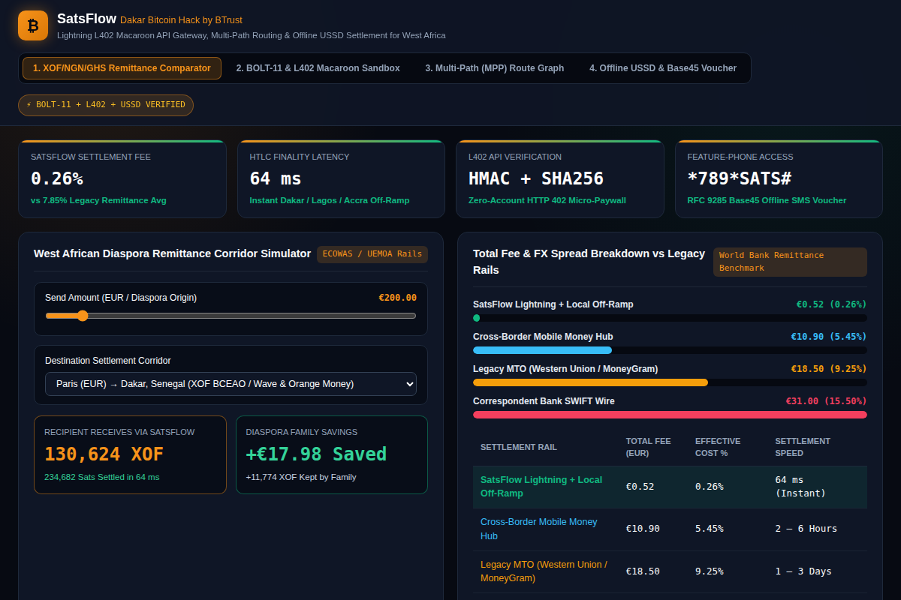
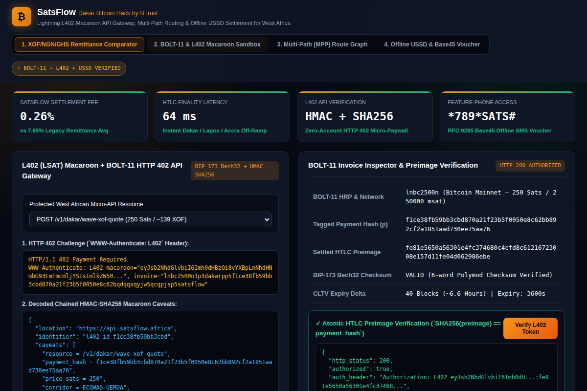
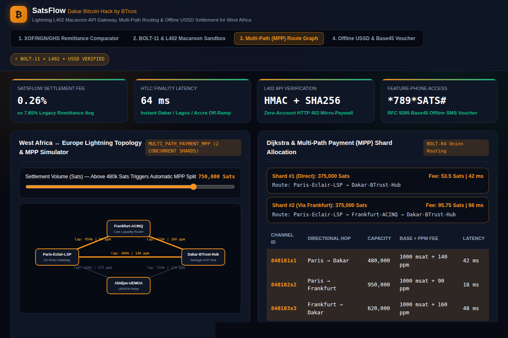

# SatsFlow: Lightning L402 & Offline-Resilient Cross-Border Micro-Settlement for West Africa

> **Dakar Bitcoin Hack by BTrust (2026) Submission**  
> **Live Interactive Web Application:** [https://jeffrey-graham.github.io/dakar-satsflow-lightning/](https://jeffrey-graham.github.io/dakar-satsflow-lightning/)  
> **60-Second 1080p Walkthrough Video:** [`demo.mp4`](demo.mp4)  
> **Core Cryptographic & Routing Engine:** [`src/satsflow_engine.py`](src/satsflow_engine.py)

---

## 1. Problem Statement

West African diaspora remittance and cross-border B2B corridors (`EUR/USD` $\leftrightarrow$ `XOF` BCEAO in Senegal & Côte d'Ivoire, `NGN` in Nigeria, and `GHS` in Ghana) suffer from **7.8%–9.5% average remittance fees** and **2–5 day settlement delays**. Simultaneously, developers building machine-to-machine APIs, solar mini-grids, and digital services across West Africa lack zero-account micro-payment rails, while millions of feature-phone users cannot access Bitcoin Lightning when mobile data connectivity drops.

---

## 2. Solution & Cryptographic Architecture (`src/satsflow_engine.py`)

**SatsFlow** is an open-source Bitcoin Lightning protocol suite and interactive settlement studio uniting four core primitives:

1. **BIP-173 Bech32 BOLT-11 Invoice Parser & Encoder:**
   - Encodes and decodes `lnbc`/`lntb` Lightning invoices with full 6-word polymod checksum verification, HRP multiplier parsing (`m`, `u`, `n`, `p`), 35-bit timestamps, tagged fields (`p` 256-bit payment hash, `d` description, `x` expiry), and atomic HTLC preimage verification ($\text{SHA256}(\text{preimage}) == \text{payment\_hash}$).
2. **L402 (`LSAT`) Chained HMAC-SHA256 Macaroon + Preimage API Paywall:**
   - Issues standard `HTTP 402 Payment Required` responses with `WWW-Authenticate: L402 macaroon="...", invoice="lnbc..."` headers and verifies chained HMAC-SHA256 caveats (`resource`, `payment_hash`, `price_sats`, `corridor`, `expires_at`) paired with HTLC preimage disclosure.
3. **Multi-Hop Dijkstra & Multi-Path Payment (MPP) Channel Liquidity Optimizer:**
   - Computes minimum-fee routes (`base_fee_msat + (amount_msat * fee_ppm) // 1,000,000`) across European and West African LSPs (`Paris-Eclair-LSP`, `Frankfurt-ACINQ`, `Abidjan-UEMOA-Gate`, `Dakar-BTrust-Hub`, `Lagos-BitNob-Core`, `Accra-Sats-Bridge`), automatically splitting large settlements into concurrent edge-disjoint **Multi-Path Payment (MPP)** shards when single-channel capacity is exceeded.
4. **Offline USSD (`*789#`) & RFC 9285 Base45 SMS Voucher Studio:**
   - Compresses HMAC-SHA256 signed Lightning settlement vouchers into single-SMS RFC 9285 Base45 strings (`SATS1:...`) and USSD dial strings (`*789*1*SATS*PIN#`) for feature-phone users in Senegal, Nigeria, and Ghana.

---

## 3. Visual Previews

| West African Remittance Corridor Comparator | L402 Macaroon & BOLT-11 Sandbox | Multi-Path Payment (MPP) Route Graph |
| :---: | :---: | :---: |
|  |  |  |

---

## 4. Quickstart & Automated Test Suite

```bash
# 1. Run the core cryptographic BOLT-11, L402, MPP & Base45 USSD engine
python3 src/satsflow_engine.py

# 2. Run the automated unit test suite
python3 -m unittest discover -s tests -v
```
